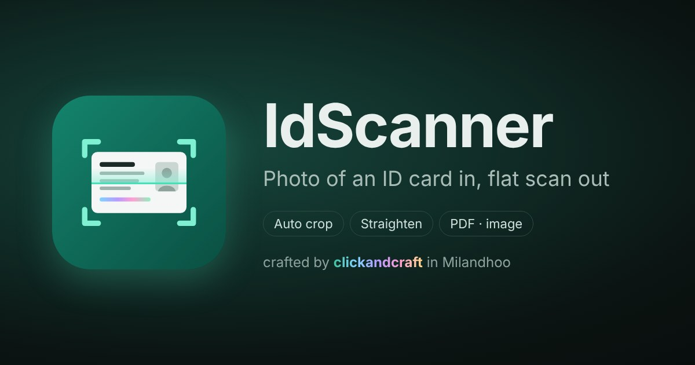

# IdScanner

Web app that turns phone photos of an ID card (front and back) into a clean, flat scan.

- Finds the card in each photo with an AI corner model (DocAligner, runs in the browser via ONNX Runtime Web), then snaps the outline to the card's edges. Falls back to an OpenCV detector if the model can't load
- Corner editor with zoom loupe for manual fixes
- Rotate, mirror, reorder, edge trim/extend
- Adjust brightness, contrast, shadows, saturation, warmth, sharpness, auto levels, grayscale, black & white
- Output sizes: ID card (85.6 × 54 mm), passport, A4, Letter, match photo, custom
- Layouts: stacked, side by side, print page (A4/Letter, true size, cut lines), separate files
- Save as PDF, PNG or JPG at 150/300/600 dpi

Single `index.html`, no server code. Everything runs in the browser; photos are never uploaded.
Needs internet on first load for OpenCV.js (jsDelivr) and jsPDF (cdnjs).

crafted by clickandcraft in Milandhoo

Third-party licences: see NOTICE.md.
